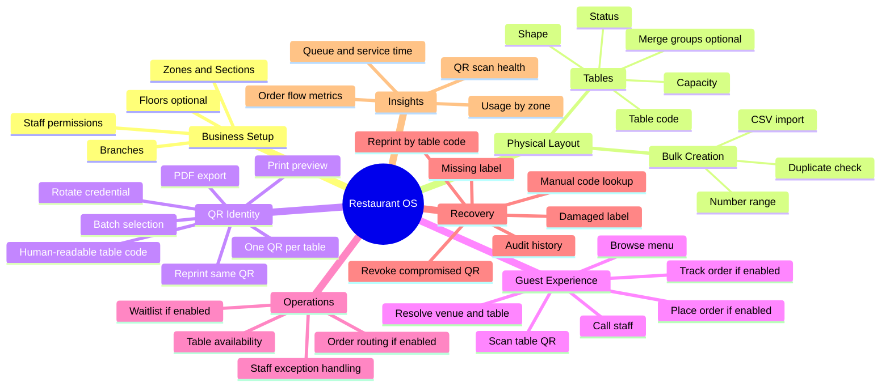
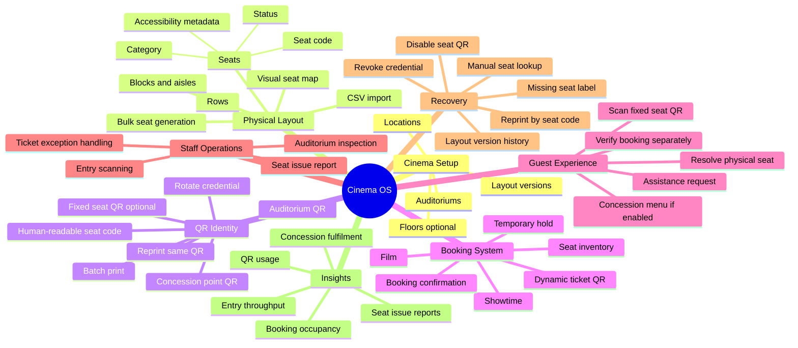
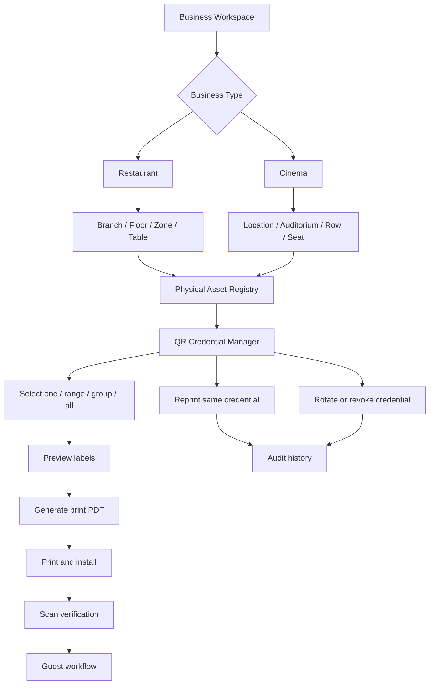

# Physical Space & QR Identity Management
## Shared concept for Restaurant OS and Cinema OS

**Status:** Product brainstorming and candidate capability specification.  
**Decision status:** The core concept is accepted for exploration; detailed workflows, MVP scope, printing format and security behaviour require validation.

---

## 1. The core idea

Every business first defines its real-world physical layout inside the platform. The system then creates a digital record for each service location or seat and can generate a QR label for it.

- Restaurant: branch → floor/zone → table → QR identity.
- Cinema: cinema location → building/floor → auditorium → row → seat → QR identity.

A manager can select one, many, or all records and generate printable QR labels in batches. Each label includes a scannable QR and a clearly readable human reference number/code. If a label is damaged, lost, dirty, removed or printed incorrectly, the manager can reprint the same active QR identity without recreating the table or seat.

**Important distinction:** Reprinting an existing QR and rotating/revoking a QR credential are different operations. Reprinting preserves the existing QR. Credential rotation creates a new QR credential and invalidates the old one according to a controlled process.

The physical table or seat identity must survive QR reprints, staff changes, menu changes, showtime changes and ordinary software updates.

## 2. Conceptual model: physical identity vs QR credential

Do not use the QR image itself as the primary identity of a table or seat.

Each physical place has a permanent internal record:
- `physical_asset_id`: immutable internal UUID.
- `business_id` and `location_id`: tenant and branch/cinema.
- `asset_type`: restaurant_table, cinema_seat, and future subtypes only if approved.
- `display_code`: human-readable number/code, e.g. T-012, A2-R03-S08.
- `display_name`: optional friendly label, e.g. Window Table 4.
- `parent_id`: hierarchy relationship, e.g. seat belongs to row and auditorium.
- `status`: active, temporarily_unavailable, maintenance, retired.
- `metadata`: carefully allow-listed properties such as capacity, accessible seating, table shape, location notes.

A QR credential is a separate, replaceable object:
- `qr_credential_id`: internal identifier.
- `physical_asset_id`: the asset it resolves to.
- `public_token`: opaque, high-entropy, unguessable token; never encode sequential database IDs or private data.
- `status`: active, revoked, expired, superseded.
- `created_at`, `revoked_at`, `created_by`, `reason`.
- `version`: increments on credential rotation, not on reprint.
- `last_printed_at` and print-job history (optional audit data).

The QR should resolve to a stable HTTPS route that looks up the active credential server-side. Avoid embedding mutable table names, prices, seat status, showtime data, customer information or secrets inside the QR itself.

### Reprint vs replace vs rotate

| Operation | What happens | Old printed QR |
|---|---|---|
| Reprint same QR | Render same active credential again | Remains valid |
| Replace damaged label | Reprint same active credential; optionally record label replacement | Remains valid |
| Rotate credential | Issue new credential/version and revoke old one | Stops resolving after rotation policy takes effect |
| Retire table/seat | Disable asset and its active guest entry point | Must not start a new session |
| Move or rename asset | Update display/location fields while preserving physical ID | QR can remain valid if identity is unchanged |

Default safe behaviour: a button named **Reprint** must never silently rotate a credential. Rotation should require a separate action, confirmation, reason and audit record.

## 3. Restaurant OS — physical layout and QR workflow

### 3.1 Layout setup

Suggested hierarchy:

```text
Restaurant Business
└── Branch / Location
    ├── Floor (optional)
    │   ├── Zone / Section (Indoor, Outdoor, Rooftop, Family)
    │   │   ├── Table T-001
    │   │   ├── Table T-002
    │   │   └── Table T-003
    │   └── Zone / Section
    └── Floor
        └── Zone / Section
```

A small restaurant should be able to skip floors and zones and simply add tables. Larger venues can use multiple floors, sections and table groups.

### 3.2 Table configuration fields (candidate)

- Table number/code; auto-numbering or manual naming.
- Display name, e.g. Patio 2 or Family Table.
- Floor and section/zone.
- Capacity / minimum and maximum covers.
- Shape/type: square, round, rectangular, booth, communal (optional).
- Accessibility notes and service notes (private to staff).
- Operational state: active, unavailable, reserved if reservations are later approved, cleaning, maintenance.
- Optional merge-group relationships for tables that can be combined.
- Optional table ordering/display position on a floor map.

Do not make reservations a dependency of table setup. A table can exist and have a QR even if reservations are not in scope.

### 3.3 Restaurant QR journey

1. Owner creates a branch and chooses **Set up tables**.
2. Owner chooses simple setup or advanced floor/zone setup.
3. Owner adds tables manually, imports a spreadsheet, or uses bulk creation (e.g. create 30 tables with a numbering pattern).
4. System previews the complete table list and catches duplicate codes.
5. Owner selects all tables, a floor, a zone, a range, or individual tables.
6. Owner chooses QR label template, paper size, label dimensions, QR size, number placement and print layout.
7. System generates a print-ready PDF and a preview.
8. Owner prints double-sided or single-sided labels depending on the chosen template and printer.
9. Staff attach each label to the corresponding table and scan-test a sample or all labels.
10. Scanning opens the restaurant guest experience with the table context preselected.
11. Guest browses menu, calls staff or orders if those capabilities are enabled by the restaurant's approved plan and product scope.

### 3.4 Restaurant mind map



### 3.5 Restaurant flexibility ideas

**Setup flexibility**
- Quick setup wizard for 5–20 tables.
- Advanced floor/zone editor for multi-floor restaurants.
- Bulk-create table ranges (T-001 to T-050).
- Custom labels (A1, Patio-03, VIP-2).
- CSV/XLSX import with validation and downloadable error report.
- Duplicate table-code detection scoped to a branch or chosen naming policy.
- Duplicate/copy a floor or zone layout for similar branches.
- Optional visual floor plan with drag-and-drop positioning; keep list view available for accessibility and speed.

**QR generation and print flexibility**
- Generate one QR, selected QRs, a range, a zone, a floor, or all QRs.
- Regenerate/reprint exactly one selected label or a batch without changing active credentials.
- Search by table code, name, floor, zone or status.
- Export PDF, print directly where supported, and optionally download individual SVG/PNG assets.
- Templates: compact sticker, table tent, acrylic stand, laminated card, standard A4 sheet.
- QR on front and table number on reverse for duplex printing, as the owner's suggested format.
- Alternative: QR and table number on the same side, useful for single-sided printers and to reduce alignment errors.
- Optional logo/brand mark and concise scan instruction, without making QR too small.
- Print calibration page with alignment marks and instructions for flip-on-long-edge/short-edge.
- Batch manifest: table code, label sequence, print date, selected zone and count.
- Print job history with who printed, when, and which records were included.
- Reprint only missing/damaged labels rather than regenerating the whole branch.

**Operational flexibility**
- Temporarily disable a table QR while the table is under maintenance.
- Move a table to a different zone without changing its permanent asset ID.
- Rename the displayed table code with a controlled uniqueness check.
- Mark table as merged/split operationally if the restaurant workflow supports it; QR resolution should remain deterministic.
- Staff can manually search/enter a table code if QR is damaged.
- If a guest scans a QR while a table is unavailable, show a helpful message and staff assistance path instead of accepting an order for the wrong table.

## 4. Cinema OS — physical layout and QR workflow

Cinema has a more complex hierarchy because seats are nested inside auditoriums and showtimes create time-bound inventory.

### 4.1 Layout setup

```text
Cinema Business
└── Cinema Location
    ├── Building / Floor (optional)
    │   ├── Auditorium 1
    │   │   ├── Screen / Stage metadata
    │   │   ├── Row A
    │   │   │   ├── Seat A-01
    │   │   │   ├── Seat A-02
    │   │   │   └── Seat A-03
    │   │   └── Row B
    │   └── Auditorium 2
    └── Auditorium 3
```

### 4.2 Auditorium and seat configuration (candidate)

**Auditorium**
- Auditorium code/name.
- Seat-map dimensions and layout version.
- Rows, aisles, blocks and exits.
- Screen orientation and accessible routes.
- Capacity and operational status.
- Optional screen/format metadata.

**Seat**
- Stable seat code, e.g. A-01 or GOLD-B-12.
- Row and block.
- Seat class/category if the cinema uses categories.
- Accessibility designation where appropriate.
- Operational state: active, blocked, maintenance, removed.
- Optional physical position coordinates for seat-map rendering.
- Optional paired/companion seat relationship, subject to accessibility review.

Do not confuse a physical seat with a booking. A physical seat exists independently of a particular film or showtime. Booking inventory is a time-bound allocation of that seat to a showtime.

### 4.3 Cinema QR uses — keep the use cases distinct

A cinema may have more than one QR concept. They should not be conflated:

1. **Seat identity QR:** fixed label on/near a physical seat. Can identify the seat for optional in-seat assistance, concessions or issue reporting.
2. **Entry ticket QR:** dynamic, booking-specific credential for admission. It is not the permanent seat QR and must not be used as a substitute for a ticket.
3. **Auditorium QR:** fixed QR at the entrance for auditorium information, assistance or showtime context.
4. **Concession/queue QR:** fixed QR at a counter or pickup point to open a concession menu or queue flow.

For a seat QR, the scanned URL identifies the cinema, auditorium and physical seat. It must not imply that the guest owns or has booked that seat. The guest's valid booking/ticket remains the authority for admission and seat entitlement.

### 4.4 Cinema QR journey

1. Manager creates cinema location and auditoriums.
2. Manager defines auditorium layout, rows, seat numbers and categories.
3. System validates duplicate seat codes, row order, capacity and layout consistency.
4. Manager previews the visual seat map and generated seat inventory.
5. Manager selects one auditorium, rows, seat categories, selected seats or all seats.
6. Manager generates seat identity QR labels in batches.
7. Manager exports print-ready PDF, including human-readable seat code.
8. Staff attach labels and verify scan results against the seat map.
9. A guest scanning a seat QR gets a seat-specific experience (e.g. assistance or concession ordering) only if enabled.
10. Ticket booking and entry validation remain separate workflows using booking-specific ticket QR credentials.

### 4.5 Cinema mind map



### 4.6 Cinema flexibility ideas

- Generate a complete seat map from row patterns (A–J, 1–20) with aisle gaps.
- Support irregular layouts, curved rows, premium blocks, accessible seating and removed seats.
- Import seat maps from CSV with validation.
- Duplicate an auditorium layout to create another auditorium, then edit exceptions.
- Version seat maps. A layout change must not silently alter historical bookings or ticket records.
- Generate QR labels for every seat, only selected seats, selected rows, or selected seat categories.
- Reprint one seat QR or a complete missing/damaged batch.
- Print seat code in large type so ushers can locate a seat without scanning.
- Optional fixed seat QR for assistance/concessions; never use it as proof of admission.
- Dynamic ticket QR should be booking-specific and protected against screenshot replay/fraud according to the validated admission model.
- If a seat QR is missing, staff can search auditorium + row + seat code manually.
- Mark seats unavailable for maintenance without deleting historical seat identity.
- When an auditorium is renovated, preserve old layout versions for historical booking and audit records.

## 5. Shared QR management workspace

A unified QR manager can serve both verticals while adapting labels and terminology.

### Dashboard concepts
- Total physical assets.
- Active QR credentials.
- Assets missing a QR label (if installation tracking is enabled).
- QR labels printed/reprinted.
- Revoked credentials.
- Assets temporarily unavailable.
- Last print jobs and operator.
- Scan health and unusual failure rates.

### Main interface
- Hierarchical left panel: location → floor/zone → room/auditorium → row/table/seat.
- Search bar for human-readable code.
- Filter by type, status, location, category and QR state.
- Select all / select range / select filtered records.
- Bulk actions: generate, preview, print, download, reprint, disable, export manifest.
- Asset detail: identity, location, status, active QR version, print history, audit log.
- Visual map and accessible list view kept in sync.

### Example workspace mind map



## 6. Double-sided printing concept

The owner's initial idea is a double-sided photocopy/print:
- Side A: QR code.
- Side B: large QR/table/seat number.

This is useful when the QR is visible on one face and the human code is visible on the reverse, or when a table tent/card is placed in a holder.

### Printing requirements
- Offer double-sided and single-sided templates.
- Let the owner choose portrait/landscape, paper size, label size, margins, rows/columns per sheet and QR dimensions.
- Provide a printer calibration sheet before printing a large batch.
- Show front/back preview together and explain paper flip direction.
- Provide a clear mapping manifest so the front QR and reverse-side code remain paired.
- Never assume all printers duplex automatically; allow manual duplex instructions.
- Include cut lines and safe margins.
- Keep sufficient QR quiet zone and contrast; do not sacrifice scan reliability for branding.
- Generate high-resolution vector QR where possible.
- Allow a test print of one selected asset before printing the entire venue.
- Support single-sided QR + code on one face as the most printer-compatible fallback.

**Critical risk:** duplex alignment varies by printer and paper feed. The system should offer calibration and test sheets, not promise perfect alignment on every printer.

## 7. QR lifecycle and recovery

### Lifecycle
```text
Asset created
   ↓
QR credential issued
   ↓
Label previewed
   ↓
Print job created
   ↓
Label installed
   ↓
Scan verified
   ↓
Active use
   ├── Reprint same credential → remains active
   ├── Label damaged/lost → reprint same credential
   ├── Asset temporarily closed → disable guest actions / show unavailable
   ├── Security concern → rotate/revoke credential
   └── Asset retired → archive asset and disable active credential
```

### Recovery scenarios
| Scenario | Recommended response |
|---|---|
| QR sticker is torn | Search asset code and reprint same active QR |
| QR is dirty or unreadable | Clean/replace label; preserve credential |
| Entire label is missing | Staff use code on physical location or asset register; reprint |
| Printed QR belongs to wrong table | Stop use, inspect mapping manifest, print correct asset; record correction |
| QR photo is being misused | Review logs, rotate credential if risk justifies invalidating old copies |
| Table/seat renamed | Update display label; preserve asset identity |
| Table/seat moved | Update location relationship and verify whether QR context should follow |
| Asset permanently removed | Retire asset; disable credential; retain history |
| Network unavailable | Show a clear unavailable state; staff fallback process; do not pretend an online order/booking was accepted |
| Staff cannot scan | Manual code lookup and staff-assisted workflow |

## 8. Security, privacy and abuse controls

- QR tokens must be random, opaque, scoped and revocable.
- Do not put sequential IDs, customer details, payment information or sensitive business data in QR payloads.
- QR resolution must validate that the credential and asset are active.
- Rate-limit public QR resolution and guest actions.
- Separate fixed physical-asset QR from booking-specific cinema ticket QR.
- Do not let scanning a seat QR bypass ticket admission or seat booking.
- Prevent duplicate order submissions using idempotency and server-side transaction rules.
- Audit credential creation, rotation, revocation, print jobs and asset retirement.
- Provide tenant isolation and staff role permissions.
- A public QR must not expose staff-only notes, internal layout metadata or private venue data.
- Define what happens when an asset is disabled while a guest session is open.
- Ensure rotation does not silently strand legitimate guests; show a safe recovery path.

## 9. Flexibility backlog — ideas to investigate

### P0 — foundational
- Physical asset registry and stable internal identity.
- Manual and bulk table/seat creation.
- Human-readable unique codes.
- QR generation and individual/batch selection.
- Reprint same active QR.
- Print-ready PDF and print preview.
- Manual search by code.
- QR credential status and audit history.
- Tenant and role protection.

### P1 — high-value operational flexibility
- Floors, zones, sections, auditoriums, rows and blocks.
- CSV import/export and duplicate validation.
- Range-based generation and reprint.
- Label templates and printer calibration.
- Print-job manifest and history.
- Temporary asset disablement and maintenance states.
- Scan verification checklist.
- Optional staff-side visual floor/seat map.

### P2 — advanced
- Drag-and-drop floor plan editor.
- Branch layout duplication.
- Bulk replacement and QR rotation workflows.
- Installation tracking (printed vs installed vs scan-verified).
- Scan health dashboard and abnormal scan alerts.
- Multi-language scan landing pages.
- Print through supported network printers.
- Asset-level service analytics and operational heatmaps.

These priorities are hypotheses, not an approved release commitment. Validate against customer research and implementation cost.

## 10. Important product decisions still open

1. Is the QR intended only to identify a table/seat, or also to start an order, assistance request or other action?
2. Should restaurant QR ordering require staff approval before kitchen submission, or go directly to the kitchen?
3. Is cinema seat QR required on every seat, or should it be optional for assistance/concessions only?
4. Should cinema entry tickets be integrated with an existing ticketing provider or built as a first-party booking system?
5. Which physical print format is the default: table tent, sticker, acrylic stand, laminated card or duplex card?
6. Should staff record label installation and scan verification, or is that too much friction for small venues?
7. Should moving an asset preserve the same QR destination context, or require a reinstallation/reassignment flow?
8. What is the desired offline fallback for staff when the internet is unavailable?
9. Are QR labels static for years, or should credentials rotate periodically based on a security policy?
10. Who is allowed to reprint, rotate, disable or retire a physical asset?

Do not block the initial prototype on every decision. Prototype the stable asset registry, bulk setup, selection, QR generation, print preview and reprint flow first.

## 11. Suggested first prototype

Build a clickable prototype before backend implementation.

### Restaurant prototype
- Create branch.
- Add 12 tables quickly.
- Group tables into Indoor and Outdoor.
- Select tables 1–6.
- Generate QR codes.
- Preview double-sided sheet (QR front, table code reverse).
- Reprint table T-004 without changing its QR.
- Search T-004 manually and show its QR status.

### Cinema prototype
- Create one cinema and two auditoriums.
- Generate rows A–F with 12 seats each.
- Remove aisle gaps and mark accessible seats.
- Select Auditorium 1, Row B.
- Generate fixed seat identity QRs.
- Preview print sheet and manifest.
- Reprint B-07 with the same QR.
- Demonstrate a separate booking ticket QR so users understand the difference.

### Prototype acceptance criteria
- A manager can create a layout without technical knowledge.
- Bulk generation avoids duplicate human-readable codes.
- The system shows exactly which assets are included before printing.
- Every QR maps to the intended asset.
- Reprinting preserves the same credential.
- Rotation is a distinct, confirmed and audited operation.
- Manual lookup works if scanning fails.
- Cinema seat identity QR is clearly distinct from booking/admission ticket QR.

## 12. Product outcome

The value is not "we can print QR codes." The value is:
- Faster venue setup.
- Fewer staff hours spent manually identifying tables/seats or handling repetitive requests.
- Faster replacement of lost/damaged labels.
- Fewer table/seat mapping errors.
- Consistent guest entry into the correct digital workflow.
- Centralised control and auditability across branches and auditoriums.

Measure setup time, label replacement time, scan success rate, misrouted guest sessions, manual lookup frequency, QR-related support incidents and downstream workflow adoption.

## 13. Scope boundary

This document captures brainstorming and candidate requirements. It does not approve a full restaurant ordering system, cinema ticketing/payment engine, reservation system, POS integration, printer integration or any unvalidated feature. The main product plan and MVP approval process remain authoritative for release scope.

---
**Related documents:** PRODUCT_PLAN.md, SYSTEM_DESIGN.md, TECHNICAL_ARCHITECTURE.md, DISCOVERY_PLAYBOOK.md, MVP_SCORECARD.md.
