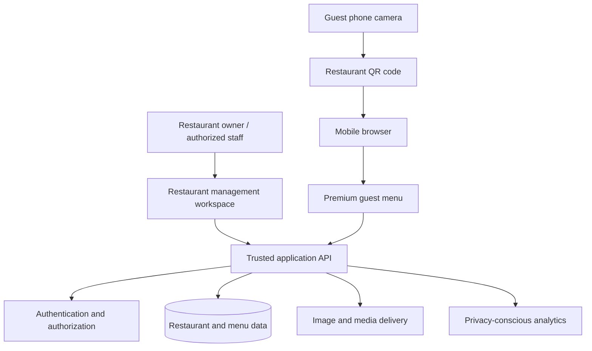

# System Design — Premium Restaurant & Café Menu Platform

> **Active system direction for Product 2 only.**
> Scope authority: [PRODUCT_PLAN.md](./PRODUCT_PLAN.md).
> Detailed candidate architecture: [TECHNICAL_ARCHITECTURE.md](./TECHNICAL_ARCHITECTURE.md).

## 1. Product boundary

The system serves quality-focused restaurants and cafés with an initial target average spend above ₹200 per person.

It has two primary experiences:
- **Restaurant workspace:** authenticated management of restaurant identity, menus, content, publishing, QR assets, and approved insights.
- **Guest menu:** polished, mobile-first browser experience opened by scanning a QR code.

This is not Product 1's free offline-first local-shop app.

## 2. Provisional context diagram

The candidate implementation stack is Flutter, Next.js, FastAPI, and Supabase, subject to product discovery and architecture approval.

## 3. Key guest journey

1. Guest scans a QR code.
2. A stable HTTPS destination opens in the phone browser.
3. The restaurant's brand identity and menu appear quickly.
4. Guest navigates menu sections and item details.
5. Guest sees current prices, descriptions, images, and verified labels.
6. The experience remains usable across supported mobile browsers and network conditions.

No owner app installation or guest account is required to view the menu.

## 4. Key management journey

1. Authorized staff sign in.
2. The workspace loads the restaurants and locations they are permitted to manage.
3. Staff edit menu content and presentation.
4. They preview the guest experience.
5. Publishing validates and safely releases the intended version.
6. The public menu receives only the published guest-safe projection.

Exact roles, approval workflows, and multi-location behavior remain discovery decisions.

## 5. Data and API principles

- Model restaurant, location, menu, section, item, media, and publication concepts only after approved domain discovery.
- Keep draft and published representations distinct.
- Enforce authorization on the server for every protected operation.
- Use explicit response DTOs for public menu data.
- Maintain stable QR destinations and version-aware cache invalidation.
- Design image transformations and caching for visual quality and fast delivery.

## 6. Reliability and observability

The platform must be testable under realistic service conditions:
- Slow mobile networks.
- Sudden network loss and recovery.
- High-traffic periods.
- Invalid or expired sessions.
- Failed image delivery.
- Stale caches after menu updates.
- Unauthorized cross-restaurant access.

Define service objectives, monitoring, alerting, backup, and rollback plans before production launch.

## 7. Unapproved capabilities

Ordering, payments, reservations, table management, POS integrations, loyalty, and other hospitality workflows are not automatically included. Each requires discovery and explicit approval.

## 8. Legacy boundary

The former local-shop PRODUCT_PLAN, PR #43 backend foundation, PR #44 Android foundation, old API_CONTRACTS.md, and old DATABASE_SCHEMA.sql belong to Product 1's earlier work. They are not approved dependencies for this system.