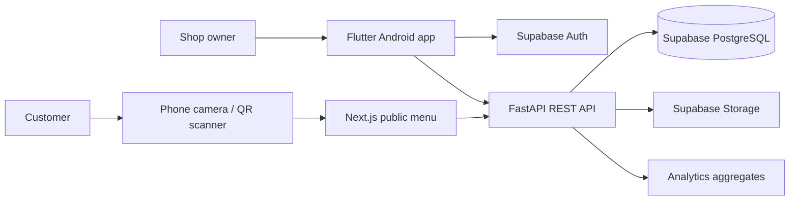
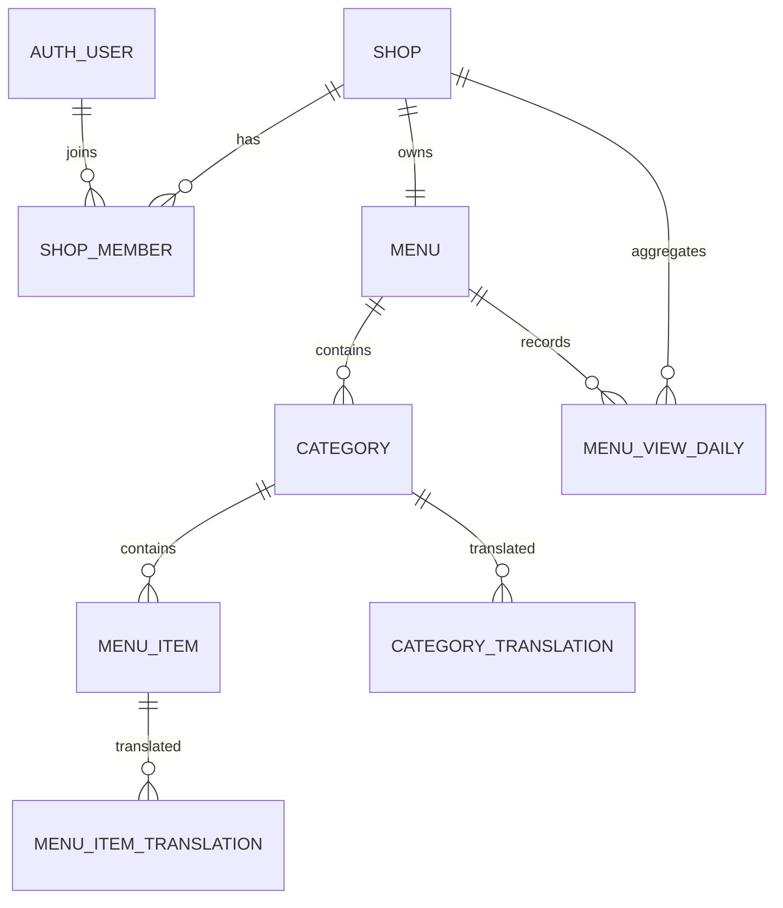

# System Design — QR Digital Menu

**Status:** Proposed baseline for implementation  
**Scope authority:** [PRODUCT_PLAN.md](./PRODUCT_PLAN.md)  
**Detailed implementation plan:** [TECHNICAL_ARCHITECTURE.md](./TECHNICAL_ARCHITECTURE.md)

## 1. Product boundary

The product has two separate client experiences:

- **Owner Android app (Flutter):** authenticated shop management.
- **Customer public menu (Next.js):** anonymous, mobile-first web page opened by scanning a QR code.

Customers never need to install the owner app, create an account, or use an app-only deep link. QR codes contain only a stable HTTPS URL: `https://<public-domain>/m/<shop-slug>`.

FastAPI is the trusted application layer. PostgreSQL is the source of truth. Supabase Auth establishes owner identity; FastAPI checks shop membership and role for every owner operation.

## 2. Container architecture

### Component responsibilities

| Component | Owns | Must not own |
|---|---|---|
| Flutter app | Owner UI, session lifecycle, forms, preview, QR rendering and sharing | Privileged secrets, authorization decisions, public menu hosting |
| Next.js public menu | Public route, rendering, language switch, theme presentation, responsive behavior | Owner writes, privileged database access |
| FastAPI | Authentication verification, authorization, validation, business rules, publishing, public DTO, analytics | UI rendering |
| PostgreSQL | Durable relational records, constraints, migrations, RLS defense in depth | Presentation logic |
| Supabase Storage | Shop logo and menu item assets | Publicly exposing private/unvalidated uploads |
| QR code | Encodes canonical public URL | Menu data or private identifiers |

## 3. Key interaction flows

### 3.1 Shop onboarding

1. Owner creates an account through Supabase Auth in Flutter.
2. Flutter receives an access token.
3. Owner submits shop name, requested slug, default language, and optional public contact details to FastAPI.
4. FastAPI verifies JWT and creates the shop, owner membership, and primary menu in one database transaction.
5. API returns shop ID, menu ID, publication state, and canonical public URL.
6. Shop is initially unpublished.

### 3.2 Menu editing and publishing

1. Flutter requests the owner's editable menu.
2. FastAPI verifies membership and returns draft categories, items, translations, branding, and theme.
3. Owner edits content; Flutter sends validated changes to the API.
4. Owner previews draft through an authenticated preview endpoint.
5. On publish, FastAPI validates that the shop/menu is publishable and commits the published state.
6. Public route reads only the published customer-safe projection.
7. Later edits do not change the shop slug or QR destination.

### 3.3 Customer scan

1. Customer scans the printed QR code using the phone camera or any scanner.
2. Browser opens `/m/{shop_slug}`.
3. Next.js requests the public menu DTO.
4. API returns only published shop/menu content.
5. Web client renders the selected language, falling back to the shop default language.
6. A privacy-minimized view event is recorded, with rate limiting and deduplication.
7. No customer authentication or app installation is requested.

### 3.4 Image upload

1. Owner requests a signed upload URL for a declared asset type and size.
2. API verifies shop membership and issues a short-lived, shop-scoped upload.
3. Flutter uploads directly to the configured storage bucket.
4. Flutter calls upload-complete endpoint.
5. API verifies object metadata and ownership before attaching the asset path to a shop/menu record.
6. Public DTO returns a safe image URL or controlled image proxy URL.

## 4. Domain model

One shop has one primary menu in this release. Multiple menus, branches, staff invitations, online ordering, checkout, payment processing, loyalty, and AI descriptions are not part of the current release.

## 5. API boundaries

- Base path: `/api/v1`.
- Owner endpoints require `Authorization: Bearer <Supabase access token>`.
- Public menu endpoints require no authentication.
- Owner writes are always authorized server-side by shop membership.
- Public API returns a dedicated DTO; do not serialize database models directly.
- Error shape and endpoint schemas are defined in [API_CONTRACTS.md](./API_CONTRACTS.md).
- Database structure and RLS policies are defined in [DATABASE_SCHEMA.sql](./DATABASE_SCHEMA.sql).

## 6. Publishing and cache consistency

- Draft records are editable by authorized owners.
- Publishing updates the menu's published state and publication timestamp.
- Public reads exclude unpublished shops/menus, hidden categories, and archived items.
- Use a short cache lifetime with explicit revalidation. Initial target: public response cache TTL no more than 60 seconds; successful publish should trigger revalidation/purge where supported.
- QR URL is immutable under ordinary edits.
- Unpublishing returns a clear unavailable/not-found public state without leaking draft data.

If a later implementation needs atomic snapshots or rollback, add versioned published snapshots as a deliberate schema change; do not add premature versioning to the first migration.

## 7. Security model

1. Verify Supabase JWT signature, issuer, audience, and expiry on every protected API request.
2. Derive user ID from the verified token; never trust user ID or role from request JSON.
3. Check membership and role for every shop-scoped operation.
4. Apply PostgreSQL RLS and least-privilege grants as defense in depth.
5. Never put service-role keys or database credentials in Flutter, public web bundles, or Git.
6. Public endpoints expose only published fields explicitly allow-listed in DTOs.
7. Validate file type, size, dimensions, and storage path; use short-lived signed uploads.
8. Rate-limit public lookups and view-event submissions.
9. Do not store raw IP addresses, customer identity, or precise location for basic menu analytics.
10. Log request IDs and safe error metadata, never tokens or sensitive content.

**Important:** If FastAPI connects using a Supabase service-role/database-owner credential, RLS may be bypassed. FastAPI authorization checks are therefore mandatory and must be tested independently.

## 8. Operational design

Environments: local development, staging, production. Each environment has separate Supabase project/database, storage bucket, API deployment, and public domain configuration.

Required operational capabilities:
- Health/readiness endpoints.
- Structured logs with request IDs.
- API latency/error monitoring.
- Database backup and restore verification.
- Storage usage monitoring.
- CI for Flutter, Next.js, FastAPI, SQL migration validation, and tests.
- Documented deployment and rollback steps.

## 9. Architecture decisions (ADRs)

| ID | Decision | Status |
|---|---|---|
| ADR-001 | Flutter for Android owner app | Accepted baseline |
| ADR-002 | Next.js public customer menu | Accepted baseline |
| ADR-003 | FastAPI as trusted application API | Accepted baseline |
| ADR-004 | Supabase PostgreSQL/Auth/Storage | Accepted baseline |
| ADR-005 | Stable HTTPS slug URL in QR code | Non-negotiable |
| ADR-006 | Public customer access without account/app | Non-negotiable |
| ADR-007 | One primary menu per shop for initial release | Accepted scope limit |
| ADR-008 | No ordering, payments, loyalty, AI or monetization in current release | Scope guardrail |

## 10. Decision ownership

The assistant owns implementation details, code, migrations, tests, and integration work. The product owner approves material product-scope changes, user-visible trade-offs, and irreversible external actions. Routine engineering choices within this approved architecture do not require repeated approval.

## 11. Acceptance criteria

- Owner can create and manage a shop only after authentication.
- A shop owner cannot read or change another shop's private records.
- Published public menu is accessible from any modern mobile browser without app install.
- QR URL remains stable after price, category, translation, branding, and theme changes.
- Unpublished menus are not exposed publicly.
- Public DTO contains no private owner or internal fields.
- All endpoints and database constraints have automated tests.
