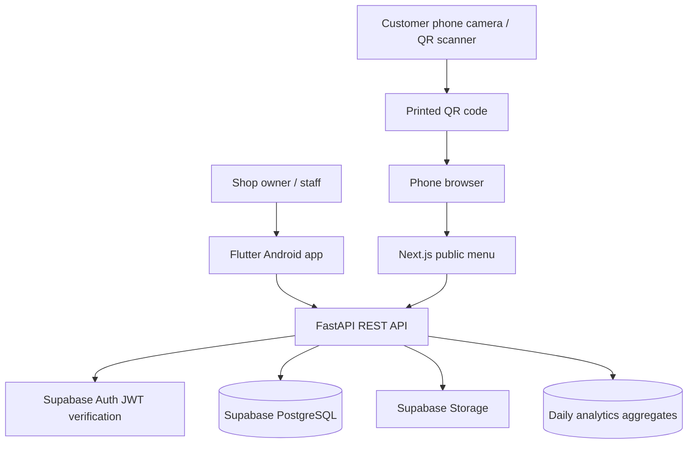

# Technical Architecture & Android Development Plan

> **Status:** Proposed technical baseline for the combined MVP + V1 release.
>
> **Product scope authority:** [PRODUCT_PLAN.md](./PRODUCT_PLAN.md)  
> **Business model:** [BUSINESS_MODEL_RESERVED.md](./BUSINESS_MODEL_RESERVED.md) — reserved until the verified 10,000-shop milestone.
>
> This document defines the implementation architecture, data model, API contracts, team/squad boundaries, delivery sequence, and engineering acceptance gates. It does not add V2 features or monetization.

---

## 1. Architecture decisions

| Area | Decision | Reason |
|---|---|---|
| Shop-owner app | Flutter (Android-first) | One maintainable mobile codebase; Android is the first delivery target |
| Customer menu | Next.js responsive web app | Opens from any QR scanner/browser; no customer app installation |
| Backend | FastAPI, versioned REST API | Central authorization, validation, publishing, and analytics rules |
| Database | Supabase PostgreSQL | Relational data, managed database, migrations, backups |
| Authentication | Supabase Auth | Owner sign-in; backend verifies Supabase JWTs |
| Image storage | Supabase Storage | Shop logos and menu-item images |
| QR generation | QR generated in owner app from canonical public URL | No QR vendor dependency; QR remains stable |
| Hosting | Next.js on Vercel; FastAPI on a suitable managed Python host | Separate public web and API deployment |
| Source control | GitHub | Issues, pull requests, CI, release history |

### Architecture guardrails

1. **The customer menu is a web page, not an Android screen.** The QR code always points to an HTTPS URL such as `https://<public-domain>/m/<shop-slug>`.
2. **The Android app is for shop owners and authorized staff.** Customers do not need an account or app.
3. **FastAPI is the trusted application boundary.** Owner writes and analytics reads go through authenticated API endpoints.
4. **The public menu endpoint returns published, customer-safe data only.** Never return owner emails, auth IDs, private settings, or unpublished drafts.
5. **The shop slug is stable.** Editing prices, items, languages, branding, or themes must not change the public URL or require a new QR code.
6. **One shop has one primary menu in the first release.** Keep the schema extensible, but do not build multi-branch or multi-menu workflows now.
7. **No ordering, checkout, payment, loyalty, AI descriptions, subscriptions, billing, or paywalls** in this release.
8. Keep the public menu fast and usable on slower mobile networks; images must be optimized and have sensible fallbacks.

---

## 2. System context



### Request paths

**Owner management**

```text
Flutter app
  -> Supabase Auth sign-in
  -> receives access token
  -> FastAPI /api/v1/* with Authorization: Bearer <token>
  -> FastAPI validates token and shop membership
  -> PostgreSQL / Storage
```

**Customer menu**

```text
Phone camera / QR scanner
  -> https://<public-domain>/m/<shop-slug>
  -> Next.js renders mobile web page
  -> public read endpoint /api/v1/public/menus/{shop_slug}
  -> only the published menu projection is returned
```

The browser does not call owner write endpoints. The public menu requires no sign-in.

---

## 3. Application responsibilities

### 3.1 Flutter Android owner app

Main navigation (suggested):

- **Home:** shop status, menu publication state, quick actions.
- **Menu:** categories and items; add/edit/reorder; availability toggle.
- **Appearance:** logo, brand color, theme selection, menu preview.
- **Languages:** default language and Gujarati/Hindi/English content.
- **QR & Share:** public link, QR preview, save/share QR image, WhatsApp share.
- **Insights:** basic menu views and daily/weekly summaries.
- **Shop settings:** profile, contact details, team access (only if included in approved account scope), sign out.

Core screens:

1. Splash and authentication.
2. Create shop profile.
3. Home/dashboard.
4. Category list and category editor.
5. Menu item list and item editor.
6. Image picker/upload progress.
7. Language editor.
8. Branding and theme picker.
9. Customer menu preview.
10. QR code and share screen.
11. Analytics screen.
12. Shop settings.

**Android implementation requirements**

- Use a feature-first Flutter structure and typed API models.
- Keep authentication/session handling in one shared layer.
- Handle loading, empty, validation, offline, expired-session, and server-error states.
- Do not store service-role keys or database credentials in the app.
- Use platform share intents for WhatsApp/device sharing; sharing must work even if WhatsApp is not installed by offering the normal share sheet.
- Generate the QR from the canonical HTTPS URL. The QR contains no menu JSON or private information.
- Support Android back navigation, accessibility labels, scalable text, and small-screen layouts.
- Cache only safe, non-sensitive data; never treat a local cache as the authoritative published menu.

### 3.2 Next.js public menu web app

Routes:

| Route | Access | Purpose |
|---|---|---|
| `/m/[shopSlug]` | Public | Customer menu |
| `/m/[shopSlug]/opengraph-image` | Public | Share preview image, if implemented |
| `/health` | Operational | Web deployment health check |

Public menu page requirements:

- Mobile-first, responsive layout.
- Shop identity, logo, selected theme, categories, items, images, prices, and availability.
- Language switcher for Gujarati, Hindi, and English when translations exist.
- Fallback to the shop's default language when a translation is missing.
- Clear unavailable state for out-of-stock items.
- Loading, not-found, unpublished, and temporary-error states.
- Semantic HTML, keyboard navigation, sufficient contrast, readable type, and image alt text.
- Search-engine/share metadata should not reveal private data.
- Do not display ordering/cart/checkout/payment controls in this release.

Prefer server rendering or equivalent server-side data loading for fast first paint and share previews. Revalidate or fetch fresh published data so owner changes appear promptly. Set a short, explicit cache policy; do not allow a long-lived stale menu response.

### 3.3 FastAPI backend

Responsibilities:

- Verify Supabase Auth JWTs.
- Resolve authenticated user's shop membership and role.
- Validate all owner input and enforce shop-level authorization.
- Manage shop, menu, category, item, translations, themes, and publication state.
- Create signed upload URLs or otherwise safely authorize image uploads.
- Serve a sanitized public menu projection.
- Record and aggregate privacy-minimized menu views.
- Expose OpenAPI documentation and health endpoints.

The backend must not trust a client-supplied `shop_id` by itself. Derive allowed shops from the verified user identity and membership records.

---

## 4. Repository structure

Use a monorepo so app, public web, API, and shared contracts evolve together.

```text
QR-scanner/
├── apps/
│   ├── owner_android/             # Flutter owner app
│   └── public_menu/               # Next.js customer menu
├── services/
│   └── api/                       # FastAPI backend
├── packages/
│   └── api_contracts/              # OpenAPI-generated types / fixtures
├── supabase/
│   ├── migrations/                 # SQL migrations
│   └── seed/                       # Development-only sample data
├── docs/
│   ├── PRODUCT_PLAN.md             # Or keep root docs if preferred
│   ├── BUSINESS_MODEL_RESERVED.md
│   ├── TECHNICAL_ARCHITECTURE.md
│   ├── API_CONTRACTS.md             # Can be split out after API stabilizes
│   └── decisions/                  # Architecture decision records
├── .github/
│   └── workflows/                  # CI checks
├── .env.example                    # Names only; never real secrets
└── README.md
```

This is the target structure, not a claim that these folders or applications have already been implemented. Keep the two existing root Markdown documents in place unless a deliberate documentation reorganization is approved.

---

## 5. Database design

Use PostgreSQL UUID primary keys, UTC timestamps, foreign keys, unique constraints, and indexes for common lookups. Store money as `numeric(10,2)` with currency code `INR` for the initial India-focused release. Do not use floating-point values for prices.

### 5.1 Core tables

| Table | Important columns | Purpose |
|---|---|---|
| `shops` | `id`, `name`, `slug`, `description`, `phone`, `address`, `logo_path`, `brand_color`, `default_language`, `is_published`, timestamps | Shop identity and public URL |
| `shop_members` | `shop_id`, `user_id`, `role`, timestamps | Maps Supabase Auth users to shops |
| `menus` | `id`, `shop_id`, `default_language`, `theme_key`, `is_published`, `published_at`, timestamps | One primary menu per shop |
| `categories` | `id`, `menu_id`, `sort_order`, `is_visible`, timestamps | Menu sections |
| `category_translations` | `category_id`, `language_code`, `name`, optional `description` | Gujarati/Hindi/English category text |
| `menu_items` | `id`, `category_id`, `price`, `currency`, `image_path`, `is_available`, `sort_order`, timestamps | Item facts and availability |
| `menu_item_translations` | `menu_item_id`, `language_code`, `name`, `description` | Localized item content |
| `menu_view_events` | `id`, `shop_id`, `menu_id`, `occurred_at`, coarse `source` | Minimal raw event data for aggregation |
| `menu_view_daily` | `shop_id`, `view_date`, `view_count` | Owner-facing daily aggregate |

### 5.2 Constraints and indexes

- `shops.slug` is unique and changes only through an explicit, audited administrative process; do not silently regenerate it.
- One primary menu per shop: unique constraint on `menus.shop_id`.
- `shop_members` unique on (`shop_id`, `user_id`).
- Supported language codes are `gu`, `hi`, and `en`; the shop chooses one default.
- Translation tables unique on (`category_id`, `language_code`) and (`menu_item_id`, `language_code`).
- Category and item `sort_order` should be indexed with their parent IDs.
- Add indexes for `shops.slug`, `menus.shop_id`, `categories.menu_id`, `menu_items.category_id`, and analytics by (`shop_id`, `view_date`).
- Deleting a category must not silently orphan items. Require explicit reassignment or a deliberate cascade workflow.
- Use soft-delete/archive semantics where recovery is useful; public menu projection must exclude archived records.

### 5.3 Data ownership and security

- Every shop-owned row must be reachable through a shop/menu ownership relationship.
- A verified user can read or write only shops where they have an authorized membership.
- Public visitors can read only the published projection for a published shop/menu.
- Do not expose Supabase service-role credentials to Flutter or Next.js client bundles.
- Apply database grants/RLS as defense in depth. FastAPI authorization remains mandatory.
- Image paths must be scoped by shop and validated for file type, size, and ownership.
- Do not store customer names, phone numbers, exact location, or raw IP addresses for menu-view analytics.

### 5.4 Publication model

Owner edits update draft data. The owner preview can display the draft to an authorized owner. Publishing makes the latest valid version available through the public endpoint.

For the first implementation, a transactionally updated `is_published` state and a sanitized read projection may be sufficient. If atomic versioned publishing is needed later, introduce `menu_versions` without changing the public URL.

---

## 6. API contracts

Base path: `/api/v1`

Format: JSON over HTTPS. Owner endpoints require `Authorization: Bearer <Supabase access token>`. Public menu endpoints do not require authentication.

Common response conventions:

- Success: resource JSON or `{ "data": ..., "meta": ... }`.
- Validation error: HTTP 422 with field-level details.
- Unauthenticated: HTTP 401.
- Authenticated but unauthorized: HTTP 403.
- Missing resource: HTTP 404.
- Conflict (duplicate slug, invalid state): HTTP 409.
- Unexpected server error: HTTP 500 with a safe error ID; never leak stack traces or secrets.

### 6.1 Authentication and shop

Authentication itself is handled by Supabase Auth SDK in Flutter.

| Method and path | Auth | Purpose |
|---|---|---|
| `GET /api/v1/me` | Owner | Current user and accessible shops |
| `POST /api/v1/shops` | Owner | Create shop and initial primary menu |
| `GET /api/v1/shops/{shop_id}` | Member | Get shop profile |
| `PATCH /api/v1/shops/{shop_id}` | Owner/admin | Update shop identity and branding |

Example create shop request:

```json
{
  "name": "Shree Snacks",
  "slug": "shree-snacks-anand",
  "default_language": "gu",
  "phone": "+91XXXXXXXXXX"
}
```

Example response:

```json
{
  "data": {
    "shop_id": "uuid",
    "menu_id": "uuid",
    "name": "Shree Snacks",
    "slug": "shree-snacks-anand",
    "public_url": "https://<public-domain>/m/shree-snacks-anand",
    "is_published": false
  }
}
```

### 6.2 Categories and items

| Method and path | Auth | Purpose |
|---|---|---|
| `GET /api/v1/shops/{shop_id}/menu` | Member | Get editable menu including drafts |
| `POST /api/v1/shops/{shop_id}/categories` | Member | Create category |
| `PATCH /api/v1/shops/{shop_id}/categories/{category_id}` | Member | Edit, reorder, or hide category |
| `DELETE /api/v1/shops/{shop_id}/categories/{category_id}` | Owner/admin | Delete after explicit item handling |
| `POST /api/v1/shops/{shop_id}/items` | Member | Create item |
| `PATCH /api/v1/shops/{shop_id}/items/{item_id}` | Member | Edit item, price, availability, or order |
| `DELETE /api/v1/shops/{shop_id}/items/{item_id}` | Owner/admin | Archive/remove item |

Example create item request:

```json
{
  "category_id": "uuid",
  "price": "85.00",
  "currency": "INR",
  "is_available": true,
  "sort_order": 1,
  "translations": {
    "gu": { "name": "ઢોસા", "description": "ગરમ અને તાજો ઢોસા" },
    "hi": { "name": "डोसा", "description": "गरम और ताज़ा डोसा" },
    "en": { "name": "Dosa", "description": "Fresh dosa served hot" }
  }
}
```

Price is represented as a decimal string in JSON to avoid floating-point ambiguity.

### 6.3 Language, branding, themes, and images

| Method and path | Auth | Purpose |
|---|---|---|
| `PUT /api/v1/shops/{shop_id}/settings/languages` | Member | Set default and enabled languages |
| `PUT /api/v1/shops/{shop_id}/branding` | Member | Set logo and brand colors |
| `PUT /api/v1/shops/{shop_id}/theme` | Member | Select an approved theme key |
| `POST /api/v1/shops/{shop_id}/uploads/presign` | Member | Request a constrained upload URL |
| `POST /api/v1/shops/{shop_id}/uploads/complete` | Member | Confirm uploaded asset metadata |

Use allow-listed theme keys rather than accepting arbitrary HTML/CSS from shop owners. Validate image MIME type, file size, dimensions, and storage path. Signed upload URLs must be short-lived and scoped to the authenticated shop.

### 6.4 Publish, preview, QR, and sharing

| Method and path | Auth | Purpose |
|---|---|---|
| `POST /api/v1/shops/{shop_id}/menu/publish` | Owner/admin | Validate and publish current menu |
| `POST /api/v1/shops/{shop_id}/menu/unpublish` | Owner/admin | Remove menu from public access |
| `GET /api/v1/shops/{shop_id}/menu/preview` | Member | Get owner-authorized draft preview |
| `GET /api/v1/shops/{shop_id}/public-link` | Member | Return canonical public URL |

QR generation is client-side using the returned canonical public URL. The QR is not a separate server-side menu resource. The app can render and export it as PNG/PDF and invoke the native share sheet.

### 6.5 Public menu

| Method and path | Auth | Purpose |
|---|---|---|
| `GET /api/v1/public/menus/{shop_slug}` | Public | Read published, sanitized menu |
| `POST /api/v1/public/menus/{shop_slug}/views` | Public | Record a privacy-minimized view |

Example public menu response:

```json
{
  "data": {
    "shop": {
      "name": "Shree Snacks",
      "slug": "shree-snacks-anand",
      "logo_url": "https://<public-storage-domain>/...",
      "brand_color": "#173B6C",
      "default_language": "gu",
      "enabled_languages": ["gu", "hi", "en"]
    },
    "menu": {
      "theme_key": "classic",
      "published_at": "2026-11-23T10:00:00Z",
      "categories": [
        {
          "id": "uuid",
          "translations": {
            "gu": { "name": "નાસ્તો" },
            "hi": { "name": "नाश्ता" },
            "en": { "name": "Snacks" }
          },
          "items": [
            {
              "id": "uuid",
              "price": "85.00",
              "currency": "INR",
              "is_available": true,
              "image_url": null,
              "translations": {
                "gu": { "name": "ઢોસા", "description": "ગરમ અને તાજો ઢોસા" },
                "hi": { "name": "डोसा", "description": "गरम और ताज़ा डोसा" },
                "en": { "name": "Dosa", "description": "Fresh dosa served hot" }
              }
            }
          ]
        }
      ]
    }
  }
}
```

Public response rules:

- Return only published, visible categories and non-archived items.
- Include availability so the customer can distinguish unavailable items.
- Do not return owner IDs, member lists, private phone/email unless explicitly designated public by the shop, internal storage paths, or unpublished content.
- Language fallback is handled by the client using the shop default language if a selected translation is absent.
- Public view recording must be rate-limited and deduplicated/coarsened to reduce abuse and inflated counts.

### 6.6 Analytics

| Method and path | Auth | Purpose |
|---|---|---|
| `GET /api/v1/shops/{shop_id}/analytics/summary?from=YYYY-MM-DD&to=YYYY-MM-DD` | Member | Aggregated views and daily trend |

Initial metrics: total menu views, daily views, and simple period comparison if reliable. Do not build customer identity tracking, ad tracking, heatmaps, or invasive profiling.

### 6.7 API rules

- Publish an OpenAPI schema from FastAPI and use it as the source for typed clients.
- Use pagination for any potentially large owner list.
- Use idempotency or safe retry behavior for publish and upload-completion operations.
- Validate UUIDs, slugs, language codes, prices, image paths, and sort order server-side.
- Use consistent timestamps in ISO 8601 UTC.
- Add request IDs and structured logs without logging access tokens or sensitive user data.
- Rate-limit public endpoints, especially view events and slug lookups.
- Version breaking API changes under a new major API path or documented version.

---

## 7. Authentication and authorization model

### Roles

- **owner:** full control of the shop, profile, menu, publishing, and member management if/when team access is enabled.
- **editor:** can edit menu content and appearance but cannot transfer ownership or perform owner-only actions.
- **viewer:** read-only owner-dashboard access, if needed.

For the initial release, a single owner account per shop is acceptable if team invitations are not part of the approved scope. Keep `shop_members` so roles can be added without redesigning shop ownership.

### Authorization sequence

1. Flutter obtains a Supabase Auth access token.
2. Flutter sends the token to FastAPI.
3. FastAPI verifies signature, issuer, audience, and expiry using the project's Supabase JWT verification configuration.
4. FastAPI reads the authenticated subject/user ID.
5. FastAPI checks membership and role for the requested shop.
6. Only then does it perform the operation.

Never accept a user ID or role supplied in the request body as proof of identity or permission.

---

## 8. Squads and ownership contracts

Squads are workstreams with explicit outputs. One person may temporarily perform multiple roles, but each contract still needs an accountable owner and reviewer.

### Squad A — Mobile Owner App

**Mission:** deliver the Flutter Android app for shop owners.

Owns:
- Flutter project setup and app navigation.
- Authentication/session UI.
- Shop profile and dashboard.
- Category/item CRUD screens.
- Translation editor.
- Branding/theme selection and preview.
- QR display/export/share.
- Analytics presentation.
- Android device testing and accessibility.

Deliverables:
- Installable debug APK for every integrated milestone.
- Screens and typed API integration.
- Unit/widget tests for core flows.
- Android QA checklist and known-issues log.

Does not own:
- Public customer web rendering.
- Database migrations or backend authorization rules.
- Monetization or V2 features.

### Squad B — Public Menu Experience

**Mission:** deliver the customer menu that works from any mobile browser.

Owns:
- Next.js public menu route.
- Responsive layouts and themes.
- Language selection/fallback.
- Public menu loading/error states.
- SEO/share metadata that is safe for public data.
- Browser/device performance and accessibility.

Deliverables:
- Deployed preview URL.
- Screenshots or test recordings for mobile widths.
- Browser compatibility test results.
- Public route acceptance evidence.

Does not own:
- Owner authentication UI.
- Menu editing.
- Ordering or checkout.

### Squad C — Backend & Data

**Mission:** provide secure, stable APIs and the relational data layer.

Owns:
- FastAPI structure and OpenAPI contract.
- Supabase Auth token verification.
- PostgreSQL schema and migrations.
- Shop tenancy and authorization.
- Menu CRUD, publishing, public projection.
- Storage upload authorization.
- Analytics ingestion and aggregation.
- API tests, rate limits, logs, and deployment.

Deliverables:
- Versioned OpenAPI specification.
- Repeatable database migrations and seed data.
- API integration tests.
- Environment variable documentation.
- Deployment and rollback instructions.

Does not own:
- Flutter screen implementation.
- Customer-facing web styling.
- Commercial model.

### Squad D — Quality, Security & Release

**Mission:** independently verify cross-platform flows and release quality.

Owns:
- Test strategy and test data.
- API contract and integration tests.
- Android real-device testing.
- Browser and QR scan testing.
- Tenant-isolation and public-data exposure tests.
- Performance, accessibility, and regression checks.
- Release checklist and defect triage.

Deliverables:
- Test plan and traceability matrix.
- Reproducible bug reports.
- Security checklist.
- Release sign-off based on evidence.

### Shared Product/Architecture owner

Owns:
- Product scope and change control.
- Priorities and acceptance criteria.
- Architecture decisions and API contract approval.
- Cross-squad dependency resolution.
- Ensuring no V2 or monetization scope leaks into the release.

---

## 9. Squad-to-squad contracts

| Producer | Must provide | Consumer contract |
|---|---|---|
| Backend & Data | OpenAPI spec, sample responses, test environment, seed shop | Mobile and Web integrate only against versioned documented contracts |
| Mobile | Owner flows, API usage, APK, test evidence | Backend receives reproducible request/response bug reports |
| Public Web | Public route, responsive menu, browser tests | Backend receives only the public menu DTO; no private queries |
| QA & Release | Test cases, defects, sign-off | All squads fix issues against acceptance criteria |

### Integration rules

- Agree API schemas before parallel UI/API implementation.
- Use mock fixtures generated from OpenAPI while backend endpoints are in progress.
- Breaking schema changes require notification and coordinated version updates.
- Every pull request must state its squad, scope, tests run, screenshots/logs where relevant, and known limitations.
- No squad may silently change another squad's contract.
- A feature is not complete because a screen exists; it is complete only when its end-to-end flow works.

---

## 10. Delivery phases and gates

The full combined MVP + V1 scope remains the release target. The phases below sequence dependencies; they do not remove features.

### Phase 0 — Foundation and contracts

- Confirm Flutter, Next.js, FastAPI, Supabase project setup.
- Create monorepo structure and CI.
- Define database migration conventions.
- Publish initial OpenAPI schemas and API error conventions.
- Define public URL/domain and slug rules.
- Add development, staging, and production environment separation.

**Gate:** app, web, and API skeletons build and deploy; health checks pass; no secrets committed.

### Phase 1 — Identity, shop, and secure data foundation

- Supabase Auth sign-in.
- Shop creation and membership.
- Shop profile and primary menu creation.
- PostgreSQL migrations, indexes, and tenant authorization.
- Basic Flutter shell and authenticated API client.

**Gate:** owner can create a shop; one shop cannot access another shop's records.

### Phase 2 — Menu management and publishing

- Category CRUD and ordering.
- Item CRUD, prices, images, availability, ordering.
- Draft menu and preview.
- Publish/unpublish.
- Public menu API projection.

**Gate:** owner can publish a complete menu; public endpoint returns only published data.

### Phase 3 — Public menu and QR end-to-end

- Next.js `/m/[shopSlug]` route.
- Mobile responsive customer menu.
- QR generation and PNG/share flow.
- Real camera scan to browser on Android and iOS.
- Stable URL verified through subsequent menu edits.

**Gate:** scan opens the menu without app install or customer login.

### Phase 4 — Complete combined V1 capabilities

- Gujarati, Hindi, English content editor and fallback.
- Shop branding.
- Multiple themes.
- WhatsApp/device link sharing.
- Basic analytics dashboard and privacy-minimized view recording.

**Gate:** all combined MVP + V1 features have end-to-end acceptance evidence.

### Phase 5 — Hardening and pilot readiness

- Tenant-isolation and public-data security testing.
- Slow-network and image-failure behavior.
- Android device matrix and browser matrix.
- Accessibility and performance review.
- Backup/restore and operational runbook.
- Pilot with real shops; record feedback and fix critical usability issues.

**Gate:** no unresolved critical security or data-loss defects; release checklist signed off.

---

## 11. Testing strategy

### Unit tests
- Price and currency validation.
- Slug normalization and uniqueness.
- Translation fallback.
- Menu publication rules.
- Role and permission checks.
- Analytics aggregation and deduplication.

### API integration tests
- Authenticated owner CRUD.
- Cross-shop access denied.
- Public endpoint rejects unpublished shop/menu.
- Public DTO contains no private fields.
- Upload path cannot escape shop scope.
- Publish/unpublish changes public visibility.
- Invalid payloads return documented errors.

### End-to-end tests
1. Create owner account.
2. Create shop and menu.
3. Add categories and translated items.
4. Add branding and select theme.
5. Publish menu.
6. Generate QR in Android app.
7. Scan QR with a phone camera where the owner app is not installed.
8. Confirm browser opens public menu.
9. Change an item price in owner app.
10. Refresh the same public URL and verify updated price without changing QR.
11. Switch language and verify fallback behavior.
12. Share the URL through WhatsApp/device share sheet.
13. Confirm aggregated view count appears in owner analytics.

### Minimum device/browser checks
- Android: at least one lower/mid-range physical device and one current device.
- Android browsers: Chrome plus one commonly used alternative.
- iOS: Safari on a physical device or a reliable device test environment.
- Screen widths: narrow phone, typical phone, and tablet/desktop responsive check.

---

## 12. Environments, secrets, and operations

Maintain separate development, staging, and production environments.

Required secret/config names (values belong in hosting secret managers, not Git):

```text
SUPABASE_URL
SUPABASE_ANON_KEY
SUPABASE_JWT_ISSUER
SUPABASE_JWKS_URL
SUPABASE_SERVICE_ROLE_KEY       # backend only; omit if not required
DATABASE_URL                    # backend only
PUBLIC_MENU_BASE_URL
API_BASE_URL
STORAGE_BUCKET_MENU_ASSETS
ENVIRONMENT
```

Rules:
- Commit only `.env.example` with placeholder values.
- Never commit real tokens, database passwords, service-role keys, or signing secrets.
- Flutter may contain public project configuration only; never embed privileged keys.
- Use HTTPS everywhere outside local development.
- Configure database backups and test restore procedures before public launch.
- Monitor API errors, latency, database capacity, storage use, and public menu availability.
- Document deploy and rollback steps.

---

## 13. Definition of done

The combined release is ready only when:

- All nine combined MVP + V1 features in PRODUCT_PLAN.md work end-to-end.
- Owner management is available in the Android app.
- Customer menu opens from a QR scan in a browser without app installation or customer login.
- QR URL stays stable through edits, theme changes, and translations.
- Public responses expose only published customer-safe information.
- Cross-shop authorization tests pass.
- Gujarati, Hindi, and English content and fallback are verified.
- Menu analytics are basic and privacy-conscious.
- WhatsApp/device sharing works.
- Automated tests and manual device/browser checks pass.
- Deployment, backup, monitoring, and rollback instructions exist.
- No V2 or monetization features have entered the release.

---

## 14. Open decisions to resolve before implementation

These are technical decisions, not reasons to block architecture work:

1. Final production domain for public menu URLs and API.
2. Whether the first release supports one owner account only or shop staff invitations.
3. Final set of initial menu themes and branding controls.
4. Exact image limits and image optimization pipeline.
5. Analytics retention period and view deduplication window.
6. Whether public shop phone/address fields are optional and explicitly opt-in.
7. Exact Flutter and Next.js versions to pin at project initialization.

Record each resolved decision in `docs/decisions/` with date, context, decision, and consequences.

---

## 15. Current implementation status

**Architecture and plan documented; implementation has not been started by this document.** Track actual progress in GitHub issues and pull requests. Do not mark a phase complete until its gate has been tested and evidenced.
